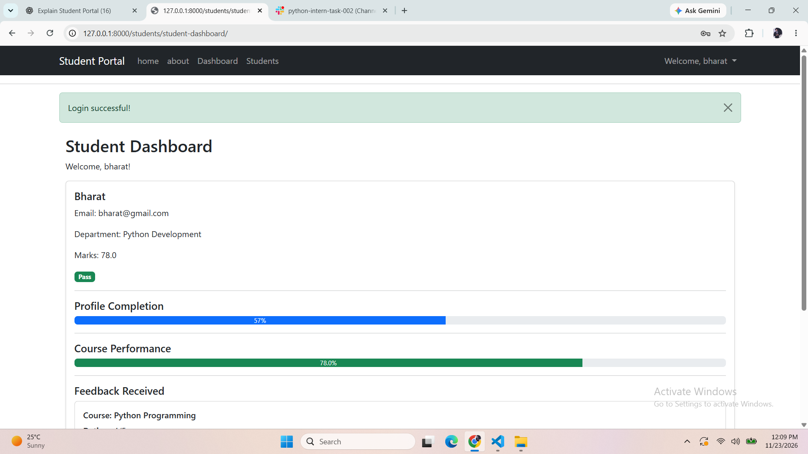

# Student Training Portal

A Django-based Student Training Portal for managing students, courses, trainers, academic performance, feedback, and user accounts through a multi-role web application.

The application provides separate dashboards and role-based workflows for **Administrators, Trainers, and Students**. It includes authentication, student management, course assignments, course-wise marks, feedback, audit logging, automated tests, and reusable Bootstrap templates.

## Table of Contents

- [Technology Stack](#technology-stack)
- [Main Features](#main-features)
- [User Roles and Permissions](#user-roles-and-permissions)
- [Project Structure](#project-structure)
- [Installation and Setup](#installation-and-setup)
- [Database Setup](#database-setup)
- [Run the Application](#run-the-application)
- [Application URLs](#application-urls)
- [Validation and Security](#validation-and-security)
- [Service Layer](#service-layer)
- [Automated Testing](#automated-testing)
- [API Design](#api-design)
- [Production Configuration](#production-configuration)
- [Screenshots](#screenshots)
- [Git Commands](#git-commands)
- [Key Concepts Practiced](#key-concepts-practiced)

## Technology Stack

| Area | Technologies |
|---|---|
| Backend | Python, Django |
| Database | SQLite (development configuration); PostgreSQL was also used during database work |
| Frontend | HTML5, CSS3, Bootstrap, JavaScript |
| Forms and validation | Django Forms, ModelForms, model validation |
| Authentication | Django Authentication System |
| Testing | Django `TestCase`, Django test client |
| Version control | Git |

## Main Features

### 1. Role-Based Authentication and Dashboards

- Three application roles: Administrator, Trainer, and Student.
- Separate dashboards for each role.
- User roles are maintained through the `UserProfile` model.
- Role-specific navigation and access restrictions.
- Reusable Django templates with Bootstrap styling.
- Login, logout, and user registration workflows.

### 2. Account Management and Password Security

- User registration for Student and Trainer roles.
- Username and email uniqueness checks.
- Password and confirm-password matching.
- Django password validation.
- Django's built-in password hashing and authentication.
- Admin-controlled user account activation and deactivation.
- Trainer account approval through account activation.
- Password change and password reset workflows using Django's built-in authentication views.

### 3. Login Protection

- Failed login attempts are tracked in `UserProfile`.
- An account is temporarily locked after five failed login attempts.
- The account lock duration is 15 minutes.
- Failed attempts are reset after successful authentication.
- Login attempts while an account is locked are blocked.
- Login-related events are recorded in the audit log.

### 4. Student Management

- Create, view, update, and delete student records.
- Student details include name, email, age, department, marks, joining date, and active status.
- Students can be associated with courses.
- Search students by name, email, or course name.
- Filter by department, course, active status, and pass/fail result.
- Paginated student listing.
- Role-based restrictions on student record access.
- Student age validation between 16 and 60.

### 5. Course and Department Management

- Department and Course data models.
- Course details include course name, unique course code, duration, active status, and assigned trainer.
- Students and courses are connected through a ManyToMany relationship.
- Course assignments are used to determine trainer access to students and course-related operations.

### 6. Trainer Dashboard and Workflow

- Trainers can view their assigned courses.
- Trainers can view students enrolled in their assigned courses.
- Trainer dashboard displays course-wise student and marks information.
- Trainers can submit feedback for students enrolled in their assigned courses.
- Trainers can edit only feedback created by themselves.
- Trainers can update marks only for students enrolled in their assigned courses.

### 7. Course-Wise Marks Management

- `CourseMarks` stores the current marks for a student in a course.
- Marks can be created or updated by the trainer assigned to that course.
- Marks must be between 0 and 100.
- An update records the user who made the change, update time, and reason.
- `MarksUpdateHistory` stores previous marks, new marks, updater, timestamp, and reason.
- Marks updates are also recorded in the audit log.
- Administrators can review marks update history.

### 8. Feedback Management

- Trainers can submit feedback for students in their assigned courses.
- Feedback includes student, trainer, course, message, rating, visibility, and creation date.
- Feedback rating is restricted to values from 1 to 5.
- Trainers can edit only their own feedback.
- Students can view their own feedback only when it is marked visible.
- Administrators can view all feedback.
- Administrators can change feedback visibility.

### 9. Audit Logging

A reusable `create_audit_log()` helper records important application activities.

Recorded events include:

- Successful login and logout.
- Failed login attempts.
- Blocked login attempts and account-lock events.
- Student creation, update, and deletion.
- Student marks changes.
- Course-wise marks updates.
- Feedback creation and updates.
- User account status changes.

Audit log records can contain:

- Username and associated user.
- Event type.
- Affected object.
- Event details.
- IP address.
- Timestamp.

Administrators can view audit logs and use search, event filtering, date-range filtering, and pagination.

## User Roles and Permissions

The application uses Role-Based Access Control (RBAC).

| Feature | Administrator | Trainer | Student |
|---|---|---|---|
| Access admin dashboard | Yes | No | No |
| Access trainer dashboard | No | Yes | No |
| Access student dashboard | No | No | Yes |
| Add student | Yes | No | No |
| Edit student | Yes | No | No |
| Delete student | Yes | No | No |
| View student list | All students | Student-list view | Own record |
| View student details | Any student | Not permitted by current detail-view decorator | Own record |
| View assigned courses | All courses through administration | Assigned courses | Enrolled courses |
| View assigned students on trainer dashboard | Yes, through administration | Assigned students | No |
| Update course marks | No | Assigned courses only | No |
| View marks history | Yes | No dedicated history page | No dedicated history page |
| Create feedback | No | Assigned students and courses only | No |
| Edit feedback | No | Own feedback only | No |
| View all feedback | Yes | No | No |
| View own visible feedback | Yes | Own submitted feedback on trainer dashboard | Yes |
| Change feedback visibility | Yes | No | No |
| View audit logs | Yes | No | No |
| Change user account status | Yes | No | No |

**Access control implementation:**

- `UserProfile` stores the user's role.
- `role_required()` is a reusable decorator for role-specific views.
- `login_required` protects authenticated views.
- Object-level filtering is used in trainer marks and feedback workflows.
- Students are restricted to their own student record and visible feedback.
- Administrative workflows are restricted to administrators.

## Project Structure

The application separates authentication, student, trainer, and administrator views. Reusable business logic is organized into service modules.

```text
student_app/
│
├── migrations/
│
├── services/
│   ├── __init__.py
│   ├── dashboard_services.py
│   ├── marks_services.py
│   └── feedback_services.py
│
├── views/
│   ├── __init__.py
│   ├── auth_views.py
│   ├── student_views.py
│   ├── admin_views.py
│   └── trainer_views.py
│
├── templates/
│   └── students/
│
├── static/
│
├── models.py
├── forms.py
├── decorators.py
├── utils.py
├── urls.py
└── tests.py
```

The main project contains `manage.py`, project settings, and the root URL configuration.

### Main Models

| Model | Purpose |
|---|---|
| `Department` | Stores department information |
| `Course` | Stores course details and assigned trainer |
| `Student` | Stores student details and course relationships |
| `StudentProfile` | Stores additional student profile information |
| `UserProfile` | Stores user role and login-lock information |
| `CourseMarks` | Stores current marks for each student-course pair |
| `MarksUpdateHistory` | Stores the history of marks changes |
| `Feedback` | Stores trainer feedback for students |
| `AuditLog` | Stores important application activity records |

## Installation and Setup

### 1. Clone the Repository

```bash
git clone <(https://github.com/Arjitshukla/Burnett_Brucke_tasks.git)>
cd training_project/my_project/
```

Navigate to the directory containing `manage.py`.

### 2. Create a Virtual Environment

```bash
python -m venv venv
```

Activate it on Windows:

```bash
venv\Scripts\activate
```

On macOS/Linux:

```bash
source venv/bin/activate
```

### 3. Install Dependencies

```bash
pip install -r requirements.txt
```

## Database Setup

Run migrations:

```bash
python manage.py makemigrations
python manage.py migrate
```

Create an administrator account:

```bash
python manage.py createsuperuser
```

The default development configuration uses SQLite. Use the database configuration defined in the project settings when running the application.

## Run the Application

Start the development server:

```bash
python manage.py runserver
```

Open the application:

```text
http://127.0.0.1:8000/
```

The student application routes are available under the `/students/` prefix, assuming the root URL configuration includes the application at that path.

Run all testCases by :

```bash
python manage.py test
```


## Application URLs

| URL | Description |
|---|---|
| `/students/` | Student list |
| `/students/add/` | Add student |
| `/students/<id>/` | Student details |
| `/students/<id>/edit/` | Edit student |
| `/students/<id>/delete/` | Delete student |
| `/students/register/` | User registration |
| `/students/login/` | User login |
| `/students/logout/` | User logout |
| `/students/dashboard/` | General dashboard |
| `/students/admin-dashboard/` | Admin dashboard |
| `/students/admin/user-status/<user_id>/` | Toggle user account status |
| `/students/admin/all-feedback/` | Admin feedback list |
| `/students/admin/feedback/visibility/<feedback_id>/` | Toggle feedback visibility |
| `/students/audit-logs/` | Audit logs |
| `/students/admin/marks-history/` | Marks update history |
| `/students/trainer-dashboard/` | Trainer dashboard |
| `/students/trainer/feedback/<student_id>/` | Submit student feedback |
| `/students/trainer/feedback/edit/<feedback_id>/` | Edit trainer feedback |
| `/students/trainer/update-marks/<student_id>/<course_id>/` | Update course marks |
| `/students/student-dashboard/` | Student dashboard |
| `/students/change-password/` | Change password |
| `/students/password-reset/` | Request password reset |
| `/students/password-reset/done/` | Password reset request confirmation |
| `/students/reset/<uidb64>/<token>/` | Set a new password |
| `/students/reset/done/` | Password reset completion |

## Validation and Security

### Form Validation

- Student age must be between 16 and 60.
- Course marks must be between 0 and 100.
- Feedback rating must be between 1 and 5.
- Registration checks required fields, duplicate usernames, duplicate email addresses, password confirmation, password strength, and allowed registration roles.

### Authentication and Authorization

- Django authentication is used for login and logout.
- Passwords are stored using Django's password hashing.
- Login protection locks an account after five failed attempts for 15 minutes.
- Role-based access is enforced on protected views.
- Trainer operations are limited to assigned courses and students.
- Students can access only their own student information and visible feedback.

### Session and Cookie Security

The project includes consideration of the following Django settings:

| Setting | Purpose |
|---|---|
| `SESSION_COOKIE_HTTPONLY` | Prevents JavaScript access to the session cookie |
| `SESSION_COOKIE_SECURE` | Sends session cookies only over HTTPS |
| `CSRF_COOKIE_SECURE` | Sends CSRF cookies only over HTTPS |
| `SESSION_EXPIRE_AT_BROWSER_CLOSE` | Controls session expiration when the browser closes |
| `SESSION_COOKIE_AGE` | Defines the session lifetime in seconds |

For local HTTP development, secure-cookie settings may be disabled. They should be enabled when deploying behind HTTPS, along with the appropriate production security configuration.

## Service Layer

Reusable business logic is separated from request-handling views.

| Service module | Responsibility |
|---|---|
| `dashboard_services.py` | Prepares trainer dashboard student and course-wise marks rows |
| `marks_services.py` | Handles student course-marks updates |
| `feedback_services.py` | Handles feedback creation and feedback updates |

This separation keeps views focused on handling requests, validating input, checking permissions, and selecting responses. The service functions can also be reused by other application interfaces where appropriate.

## Automated Testing

The project uses Django's testing framework, including `TestCase` and the Django test client.

Run the complete test suite:

```bash
python manage.py test
```

Run tests for the application:

```bash
python manage.py test student_app
```

### Testing Coverage

The test suite covers areas including:

- Authentication page and login behavior.
- Invalid login credentials.
- Failed login attempt tracking.
- Successful login and failed-attempt reset.
- Account locking after repeated failed attempts.
- Blocking login for locked accounts.
- Authentication audit logging.
- Role-based access restrictions.
- Student data access restrictions.
- Trainer marks-update permissions.
- Direct POST permission enforcement.
- Feedback access restrictions.
- Administrator access to feedback and marks history.
- Marks validation.

**Latest test result recorded during project verification: 35 tests passed, 0 failures.**

To verify the current checkout, run `python manage.py test` and use the result printed by Django.

## API Design

An API planning document is maintained separately in [`api_design.md`](api_design.md).

It describes proposed REST endpoints for:

- Students.
- Courses.
- Student-course enrollments.
- Course-wise marks and marks history.
- Feedback.

**Important:** `api_design.md` is an API design document. The endpoints described there are proposed API designs and should not be considered implemented REST endpoints in the current Django web application.

## Production Configuration

The project includes a separate production settings configuration.

Before deployment:

- Set `DEBUG = False`.
- Load `SECRET_KEY` from environment variables.
- Configure `ALLOWED_HOSTS`.
- Configure the production database.
- Configure the production email backend.
- Configure HTTPS and secure cookies.
- Collect static files.
- Apply database migrations.
- Run the automated test suite.

### Environment Variables

Configure the environment variables required by the project's settings. For example:

```env
SECRET_KEY=your-generated-secret-key
DEBUG=False
ALLOWED_HOSTS=your-domain.com,localhost
```

Add any database and email variables required by the active settings configuration. Do not commit real credentials or secret values to Git.

### Production Checks

Run the production configuration check:

```bash
python manage.py check --settings=my_project.production
```

Apply migrations:

```bash
python manage.py migrate --settings=my_project.production
```

Collect static files:

```bash
python manage.py collectstatic --settings=my_project.production
```

### Sample Data

If the custom sample-data management command is included in the project, it can be run with:

```bash
python manage.py load_sample_data
```

Use demo data and credentials only in local or test environments. Never use demo passwords in production.

## Screenshots

Add screenshots to the `screenshots/` directory and update the filenames below to match the actual image files in the repository.

### Administrator Dashboard


### Trainer Dashboard


### Student Dashboard



### Registration Page


### Login Page


### Add Student Form


### Feedback Form


### Marks Update Form


### Audit Logs


### Marks History


## Git Commands

Check the working tree:

```bash
git status
```

Stage the README update:

```bash
git add README.md
```

Commit the update:

```bash
git commit -m "Update project README documentation"
```

Push the commit:

```bash
git push
```

## Key Concepts Practiced

- Django project and application structure.
- Django Models, ORM, and Migrations.
- Django Admin and Superuser.
- Views, URL routing, and Templates.
- ModelForms and custom validation.
- GET and POST request handling.
- CRUD operations.
- Query filtering with `Q` objects.
- Pagination.
- `select_related()` and `prefetch_related()`.
- Django Messages Framework.
- Redirects and rendering.
- Django Authentication System.
- Password hashing and validation.
- Role-Based Access Control (RBAC).
- Sessions and Cookies.
- Password Change and Password Reset.
- Login attempt tracking and temporary account locking.
- Audit logging.
- Feedback management.
- ManyToMany student-course relationships.
- Course-wise marks management and update history.
- Reusable service functions.
- Django automated testing.
- Bootstrap forms, tables, cards, and alerts.
- Git version control.

---

**Project:** Student Training Portal  
**Backend:** Python, Django  
**Frontend:** HTML, CSS, Bootstrap, JavaScript  
**Database:** SQLite (development configuration)  
**Testing:** Django TestCase  
**Version Control:** Git
