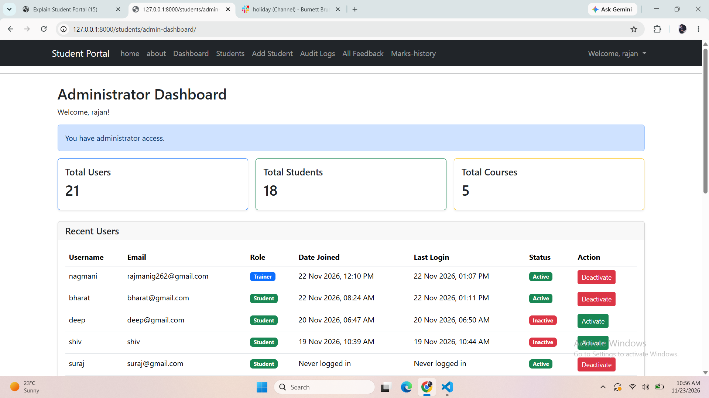
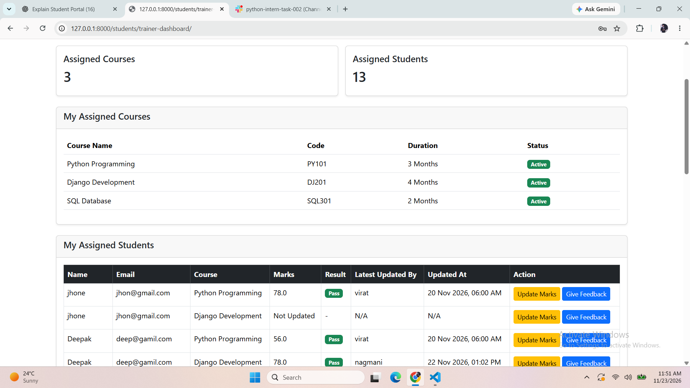
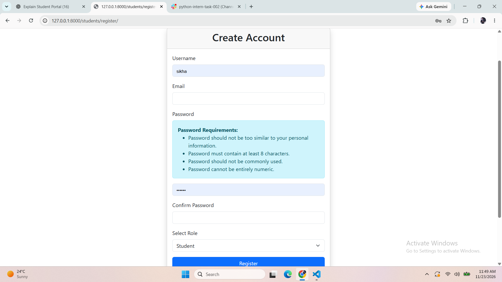
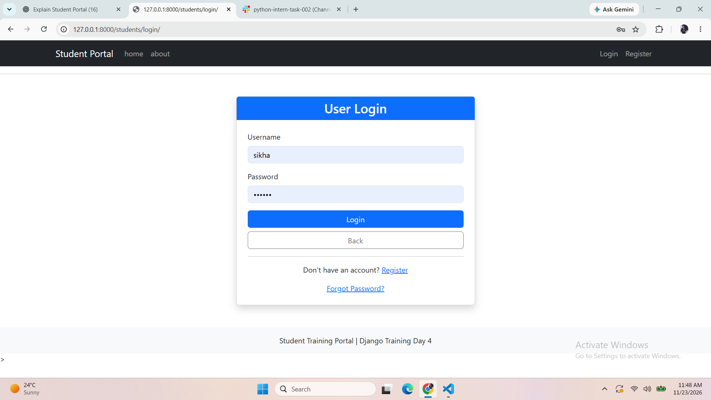
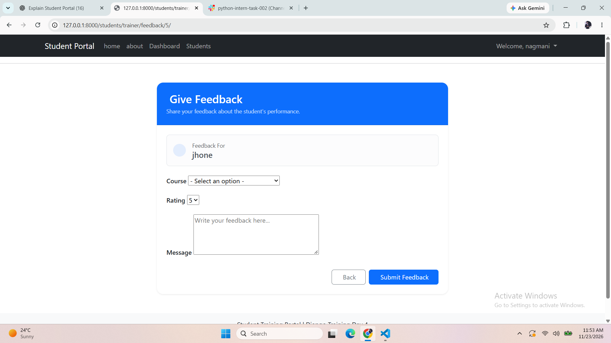
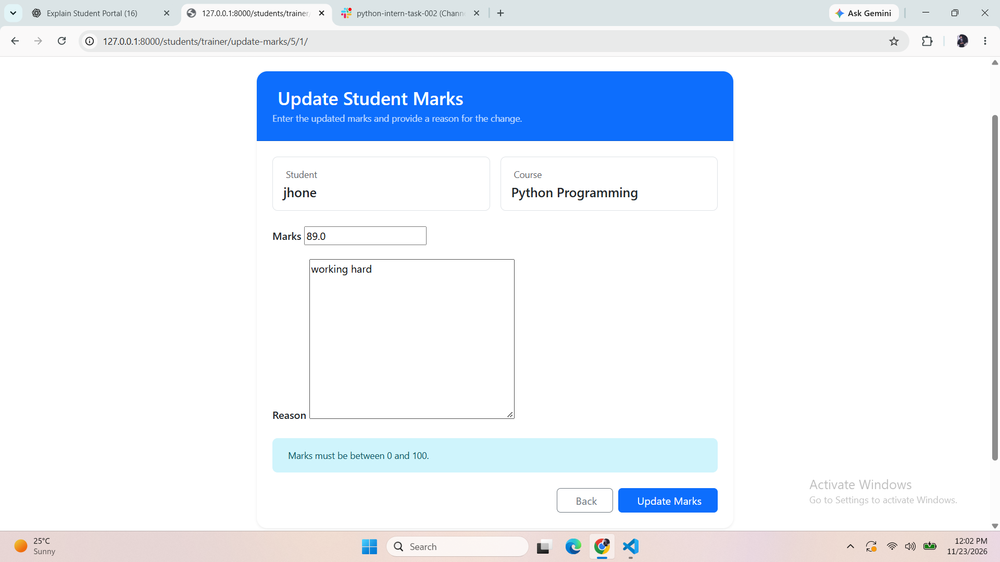
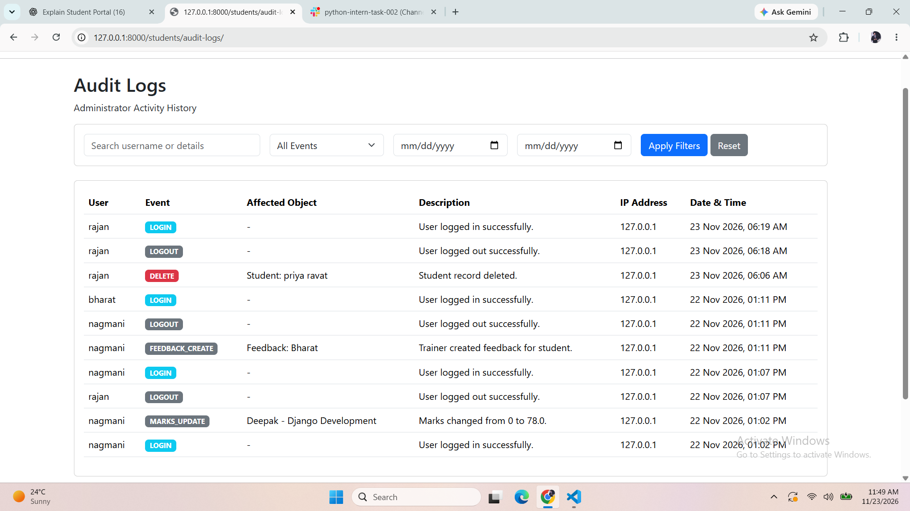
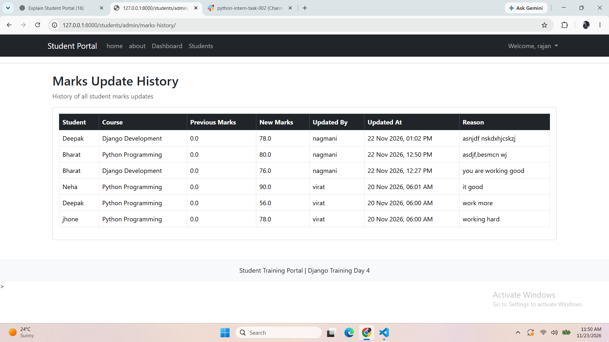

# Student Training Portal

A Django-based Student Training Portal designed to manage students, trainers, courses, academic performance, feedback, and user accounts through a secure multi-role application.

The application provides separate dashboards for Administrators, Trainers, and Students, with role-based permissions, authentication, audit logging, and reusable Bootstrap templates.

## 1. Technology Stack

- Python
- Django
- SQLite
- HTML5
- CSS3
- Bootstrap
- JavaScript
- Git

## 2. Project Setup

### Clone Repository

```bash
git clone <repository-url>
cd "main Interships/training_project/my_project"
```

### Create and Activate Virtual Environment


```bash
python -m venv venv
```

Windows:

```bash
venv\Scripts\activate
```

### Install Dependencies

```bash
pip install -r requirements.txt
```

## 3. Database Setup

Run the following commands:

```bash
python manage.py makemigrations
python manage.py migrate
python manage.py createsuperuser
```

## 4. Run Development Server

```bash
python manage.py runserver
```

Open the application:

[http://127.0.0.1:8000/](http://127.0.0.1:8000/)

## 5. Application URLs

All application URLs below are under the `/students/` prefix, assuming the app is included at that path in the main project URL configuration.

| URL                                                        | Description                 |
| ---------------------------------------------------------- | --------------------------- |
| `/students/`                                               | Student List                |
| `/students/add/`                                           | Add Student                 |
| `/students/<id>/`                                          | Student Details             |
| `/students/<id>/edit/`                                     | Edit Student                |
| `/students/<id>/delete/`                                   | Delete Student              |
| `/students/register/`                                      | User Registration           |
| `/students/login/`                                         | User Login                  |
| `/students/logout/`                                        | User Logout                 |
| `/students/dashboard/`                                     | General Dashboard           |
| `/students/admin-dashboard/`                               | Admin Dashboard             |
| `/students/trainer-dashboard/`                             | Trainer Dashboard           |
| `/students/student-dashboard/`                             | Student Dashboard           |
| `/students/admin/user-status/<id>/`                        | Change User Account Status  |
| `/students/audit-logs/`                                    | Audit Logs                  |
| `/students/admin/all-feedback/`                            | Admin Feedback Management   |
| `/students/admin/feedback/visibility/<id>/`                | Change Feedback Visibility  |
| `/students/trainer/feedback/<student_id>/`                 | Give Student Feedback       |
| `/students/trainer/feedback/edit/<feedback_id>/`           | Edit Own Feedback           |
| `/students/trainer/update-marks/<student_id>/<course_id>/` | Update Course Marks         |
| `/students/admin/marks-history/`                           | Marks Update History        |
| `/students/change-password/`                               | Change Password             |
| `/students/password-reset/`                                | Request Password Reset      |
| `/students/password-reset/done/`                           | Password Reset Confirmation |
| `/students/reset/<uidb64>/<token>/`                        | Set New Password            |
| `/students/reset/done/`                                    | Password Reset Complete     |

## 6. Project Features

### Task 1: Role-Based Authentication and Dashboard Design

- Implemented role-based authentication for Administrator, Trainer, and Student.
- Created separate dashboards for all three roles.
- Implemented reusable Django templates.
- Used Bootstrap for responsive page design.
- Added role-specific navigation.
- Protected views using role-based permissions.

### Task 2: Secure Account Management

#### Registration and Authentication

- Implemented user registration, login, and logout.
- Added username and email uniqueness validation.
- Implemented student and trainer registration.
- Added administrator-controlled account activation and deactivation.
- Implemented trainer account approval through account activation.

#### Password Security

- Implemented minimum 8-character password validation.
- Added uppercase, lowercase, digit, and special character requirements through configured password validation.
- Prevented passwords similar to username and email using Django password validators where applicable.
- Implemented password and confirmation matching.
- Used Django's built-in password hashing and authentication mechanisms.

#### Password Reset

- Implemented password reset using Django built-in authentication views.
- Added password reset email templates.
- Implemented password reset confirmation and completion pages.

#### Login Protection

- Tracks failed login attempts using the UserProfile model.
- Temporarily locks accounts after five failed login attempts.
- Implements a 15-minute account lock.
- Resets failed attempts after successful authentication.
- Prevents login while an account is locked.
- Displays Bootstrap alerts for login errors and account lock messages.

#### Session and Cookie Security

Studied and documented the following Django security settings:

- `SESSION_COOKIE_HTTPONLY`
- `SESSION_COOKIE_SECURE`
- `CSRF_COOKIE_SECURE`
- `SESSION_EXPIRE_AT_BROWSER_CLOSE`
- `SESSION_COOKIE_AGE`

Secure-cookie settings require HTTPS in production. They should be configured appropriately for local HTTP development.

### Task 3: Audit Logs, Feedback and Secure Marks Workflow

#### Audit Logs

Implemented a reusable `create_audit_log()` helper to record important application activities.

Recorded activities include:

- Successful login.
- Logout.
- Failed login.
- Account lock and blocked login attempts.
- Student creation.
- Student updates.
- Student deletion.
- Marks updates.
- Feedback creation.
- Account status changes.
- Feedback updates.

Audit log information includes:

- Username and associated user.
- Event type.
- Affected object.
- Event description.
- IP address.
- Timestamp.

Additional functionality:

- Admin-only audit log access.
- Search functionality.
- Event filtering.
- Date-range filtering.
- Pagination.
- Bootstrap event badges.
- Empty-state display.

#### Feedback Management

- Trainers can submit feedback only for students assigned to their courses.
- Trainers can edit only their own feedback.
- Feedback includes course, rating, message, trainer, and student information.
- Rating is restricted to values from 1 to 5 through model choices.
- Students can view only feedback marked visible.
- Administrators can view all feedback.
- Administrators can change feedback visibility.
- Feedback is displayed using Bootstrap cards.

#### Secure Marks Management

- Trainers can update marks only for students assigned to their courses.
- Marks are validated between 0 and 100.
- Students are blocked from accessing trainer marks-update functionality.
- Marks changes record previous marks, new marks, updater, date, and reason.
- Each update creates a MarksUpdateHistory record.
- Marks changes are also recorded in AuditLog.
- Trainer dashboard displays course-wise marks, latest updater, and update date.
- Administrators can view marks update history.

### Task 4: Django Models and Admin

- Created Student model with required student information.
- Implemented Department and Course models.
- Added student-course relationships.
- Created UserProfile for role management.
- Applied migrations and registered relevant models in Django Admin.
- Added student records through Django Admin.
- Implemented active student information and Pass/Fail status.

### Task 5: Django ModelForm

- Created StudentForm using ModelForm.
- Implemented Add Student functionality.
- Added Age (16–60) and Marks (0–100) validation.
- Implemented validation errors and success messages.

### Task 6: Student CRUD Operations

- Implemented List, Detail, Add, Edit, and Delete functionality.
- Created a delete confirmation page.
- Used separate views, URLs, and templates.
- Implemented redirects and validation error handling.
- Added search, filtering, and pagination.
- Restricted student data visibility according to user roles.

## 7. Role and Permission Matrix

The application uses Role-Based Access Control (RBAC) with three roles: Administrator, Trainer, and Student.

| Feature / Permission           | Administrator |         Trainer        |   Student   |
| ------------------------------ | :-----------: | :--------------------: | :---------: |
| Access Admin Dashboard         |      Yes      |           No           |      No     |
| Access Trainer Dashboard       |       No      |           Yes          |      No     |
| Access Student Dashboard       |       No      |           No           |     Yes     |
| Manage Student Records         |      Yes      |           No           |      No     |
| View All Student Records       |      Yes      |           Yes          |      No     |
| View Own Student Record        |      Yes      |           Yes          |     Yes     |
| Manage Courses and Departments |      Yes      |           No           |      No     |
| Manage User Accounts           |      Yes      |           No           |      No     |
| View Assigned Courses          |      Yes      |           Yes          | Own Courses |
| View Assigned Students         |      Yes      |           Yes          |      No     |
| Update Course Marks            |       No      | Assigned Students Only |      No     |
| View Marks History             |      Yes      |           No           |      No     |
| Create Feedback                |       No      | Assigned Students Only |      No     |
| Edit Feedback                  |       No      |    Own Feedback Only   |      No     |
| View All Feedback              |      Yes      |           No           |      No     |
| View Visible Feedback          |      Yes      |           No           |     Yes     |
| Change Feedback Visibility     |      Yes      |           No           |      No     |
| View Audit Logs                |      Yes      |           No           |      No     |
| Change User Account Status     |      Yes      |           No           |      No     |

### Access Control Implementation

- User roles are managed through the `UserProfile` model.
- Student accounts are linked to student records through the Django User relationship.
- The `role_required` decorator protects role-specific views.
- Unauthorized requests are rejected by backend permission checks.
- Object ownership is checked to prevent unauthorized access through URL ID manipulation.
- Trainers can access only their assigned students and courses for marks updates and feedback.
- Students can access only their own student records and visible feedback.
- Administrative pages are restricted to administrators.

## 8. Automated Testing

Automated tests are implemented using Django's `TestCase` and test client.

### Run Tests

```bash
python manage.py test student_app
```

### Testing Coverage

The current test suite contains 20 automated test cases covering:

- Login and registration page loading.
- Invalid login credentials.
- Failed login attempt tracking.
- Successful login and attempt counter reset.
- Account locking after five failed attempts.
- Blocking login for locked accounts.
- Login audit logging.
- Failed login audit logging.
- Student and trainer access restrictions.
- Student data privacy.
- Trainer marks-update permissions.
- Direct POST permission enforcement.
- Feedback access restrictions.
- Admin access to feedback and marks history.
- Marks validation.

**Latest test result: 20 tests passed, 0 failures.**

## 9. Session and Cookie Security

### Important Django Settings

| Setting                           | Purpose                                                |
| --------------------------------- | ------------------------------------------------------ |
| `SESSION_COOKIE_HTTPONLY`         | Prevents JavaScript from accessing the session cookie. |
| `SESSION_COOKIE_SECURE`           | Sends session cookies only over HTTPS.                 |
| `CSRF_COOKIE_SECURE`              | Sends CSRF cookies only over HTTPS.                    |
| `SESSION_EXPIRE_AT_BROWSER_CLOSE` | Controls session expiration when the browser closes.   |
| `SESSION_COOKIE_AGE`              | Defines session lifetime in seconds.                   |

### Local Development vs Production

During local HTTP development, secure-cookie settings can remain disabled:

```python
SESSION_COOKIE_SECURE = False
CSRF_COOKIE_SECURE = False
```

For production with HTTPS enabled:

```python
SESSION_COOKIE_SECURE = True
CSRF_COOKIE_SECURE = True
```

These settings should be configured according to the deployment environment.

## 10. Known Limitations and Future Improvements

The following areas can be improved before production deployment:

1. Login attempt tracking is currently based on the username and database profile; IP-based rate limiting is not implemented.
2. Redis or distributed caching can be introduced for scalable login protection.
3. Concurrent login attempts may require stronger atomic update handling.
4. Audit log protection can be strengthened with restricted database-level modification and centralized monitoring.
5. Production email delivery requires a properly configured email backend.
6. HTTPS, secure cookies, and production deployment settings must be configured before deployment.
7. Automated tests should be expanded to cover every remaining form-validation, audit-event, and template-rendering scenario.

## 11. Screenshots for Submission

Add screenshots of the following application pages to demonstrate the implementation:

### Administrator Dashboard.

### Trainer Dashboard.

### Student Dashboard.

### User Registration Form.

### Login Form.


- Add Student Form.

### Feedback Form.

### Marks Update Form.

### Audit Logs Page.

- Marks History Page.


## 12. Git Submission

Check modified files:

```bash
git status
```

Stage project changes:

```bash
git add .
```

Commit changes:

```bash
git commit -m "Complete Student Training Portal implementation"
```

Get the final commit ID:

```bash
git rev-parse HEAD
```

Record the generated commit ID in the project submission details.

## 13. Topics Learned

- Django Models, ORM, and Migrations.
- Django Admin and Superuser.
- Views, URLs, and Templates.
- ModelForm and Custom Validation.
- GET and POST Requests.
- CRUD Operations.
- `get_object_or_404()`.
- Django Messages Framework.
- Redirect and Render.
- Django Authentication System.
- Password Hashing and Validation.
- Role-Based Access Control (RBAC).
- Django Sessions and Cookies.
- Password Reset and Password Change.
- Login Attempt Tracking.
- Audit Logging.
- Feedback Management.
- Course-wise Marks Management.
- Django Security Best Practices.
- Bootstrap Forms, Tables, Cards, and Alerts.
- Django Automated Testing.

---

**Project:** Student Training Portal

**Backend:** Python and Django

**Frontend:** HTML, CSS, Bootstrap, JavaScript

**Database:** SQLite / PostgreSQL

**Testing:** Django TestCase

**Version Control:** Git
